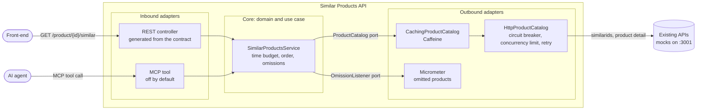
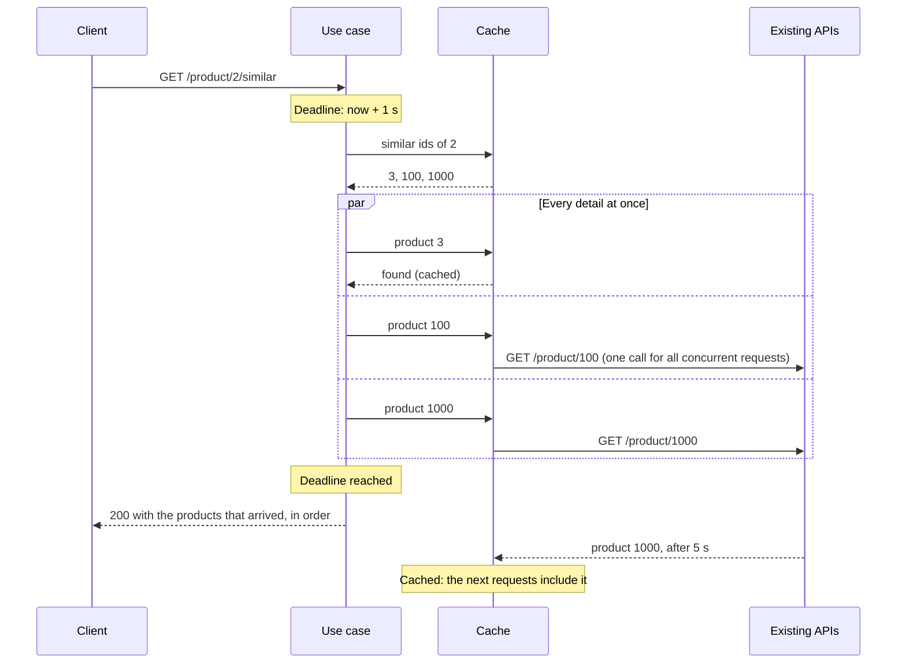

# Similar Products API

[](https://github.com/adriansanluis2000/similar-products-api/actions/workflows/ci.yml)

Solution to the [backend dev technical test](docs/statement.md) from [dalogax/backendDevTest](https://github.com/dalogax/backendDevTest): a Spring Boot service that exposes `GET /product/{productId}/similar` on port 5000 and returns the details of the products similar to a given one, built on top of two existing APIs.

Under the load test of the statement, the final release answers with a median of 3 to 5 ms in every scenario, never makes a request wait much longer than a second whatever the upstream does, returns slow products once they have arrived, and answers no errors. When the upstream goes down, it keeps serving what it has cached and fails fast for the rest.

> **Status:** complete. Latest release: `v1.2.0`, also published as a container image on the GitHub Container Registry.

## Quick start

### With Docker

Requires Docker with Compose. One command builds the image and starts the application next to the mocks, InfluxDB and Grafana of the statement:

```bash
docker compose up -d simulado influxdb grafana app
```

Then run the load test of the statement:

```bash
docker compose run --rm k6 run scripts/test.js
```

Results are shown in Grafana at <http://localhost:3000/d/Le2Ku9NMk/k6-performance-test>. [`scripts/perf-report.sh`](scripts/perf-report.sh) runs the same test and prints the results per scenario as a table (see [Performance](#performance)).

After changing the code, add `--build` to rebuild the image. [`docker-compose.override.yaml`](docker-compose.override.yaml) adds the application to the infrastructure of the statement, whose compose file is left untouched. The image is described in [ADR 0011](docs/adr/0011-container-image.md), and every release tag publishes it as `ghcr.io/adriansanluis2000/similar-products-api`.

### Locally

Requires JDK 25 and the mocks running (`docker compose up -d simulado influxdb grafana`):

```bash
cd app
./mvnw spring-boot:run
```

The API listens on <http://localhost:5000>, with its health check at <http://localhost:5000/actuator/health>. To build and run all the checks, use `./mvnw verify`.

## How it works

### Architecture

A hexagonal architecture ([ADR 0003](docs/adr/0003-hexagonal-architecture.md)): the use case and the domain are plain Java, and everything that talks to the outside world is an adapter around them. ArchUnit enforces the dependency rules in the build.



### A request, step by step

The use case starts every lookup at once and answers when the time budget runs out, with whatever has arrived. Lookups are not cancelled: they finish in the background and land in the cache, where concurrent requests share them.



## API

`GET /product/{productId}/similar` returns the detail of the products similar to the given one, ordered by similarity, as agreed in [`similarProducts.yaml`](similarProducts.yaml). Errors are [RFC 9457](https://www.rfc-editor.org/rfc/rfc9457) problem details.

| Situation | Response |
|---|---|
| The product exists | 200 with its similar products. Those whose detail cannot be retrieved (404, error or timeout) or does not arrive within the time budget are left out, and repeated ids are returned once |
| The product does not exist | 404 |
| The product id is not 1 to 64 letters, digits, `-` or `_` | 400 |
| The existing APIs fail or cannot be reached when asked for the similar ids | 502 |
| They do not answer the similar ids within the time budget | 504 |
| They are not being called for a while, after failing too often or because too many calls are in progress | 503, with `Retry-After` |

The reasons behind these rules are in [ADR 0004](docs/adr/0004-similar-products-business-rules.md) and [ADR 0010](docs/adr/0010-map-upstream-failures-to-gateway-errors.md).

### Against the mocks

What each scenario of the load test gets. The end-to-end tests check every row against the real mock image and `mocks.json`.

| Scenario | Request | Similar ids | Upstream behaviour | Answer |
|---|---|---|---|---|
| normal | `/product/1/similar` | 2, 3, 4 | All fine; product 3 takes 100 ms | 200 with 2, 3, 4 |
| notFound | `/product/4/similar` | 1, 2, 5 | Product 5 answers 404 | 200 with 1, 2 |
| error | `/product/5/similar` | 1, 2, 6 | Product 6 answers 500 without a body | 200 with 1, 2 |
| slow | `/product/2/similar` | 3, 100, 1000 | Product 100 takes 1 s, product 1000 takes 5 s | 200 within about a second; 100 and 1000 join the answer once they have arrived |
| verySlow | `/product/3/similar` | 100, 1000, 10000 | Product 10000 takes 50 s | 200 within about a second with 100 and 1000 once they have arrived; 10000 is never waited for |
| — | `/product/99/similar` | Not mocked: 404 | — | 404 |

## Performance

Every improvement was measured with the load test of the statement, on the same machine, with the mock restarted before each run. p95 per scenario:

| Stage | normal | notFound | error | slow | verySlow |
|---|---:|---:|---:|---:|---:|
| Baseline: sequential lookups (`v0.1.0`) | 539 ms | 260 ms | 267 ms | 3363 ms | 5229 ms |
| Parallel lookups on virtual threads | 608 ms | 113 ms | 149 ms | 2142 ms | 2225 ms |
| Time budget per request | 549 ms | 130 ms | 167 ms | 1045 ms | 1039 ms |
| Cache with coalescing and negative caching | 201 ms | 50 ms | 40 ms | 1046 ms | 1044 ms |
| Circuit breaker, concurrency limit, retry, gateway errors (`v0.2.0`) | 194 ms | 43 ms | 42 ms | 1042 ms | 1043 ms |
| Final release, in Docker (`v1.2.0`) | 38 ms | 17 ms | 14 ms | 1009 ms | 1017 ms |

The p95 of `slow` and `verySlow` is the time budget by construction: the requests that arrive while a slow product is fetched for the first time wait for it until the deadline. From then on they are answered from the cache in a few milliseconds. The fast scenarios reach the ceiling of the test, 400 requests per second.

[`docs/performance.md`](docs/performance.md) has the method, the environment, the full tables and the Grafana dashboard of each stage, and an outage experiment ([`scripts/outage-test.sh`](scripts/outage-test.sh)) that pauses the mocks while requests keep coming.

## Key decisions

Each decision is recorded as an [architecture decision record](docs/adr/README.md), with the alternatives considered and the trade-offs accepted.

- **Contract first** ([0002](docs/adr/0002-generate-api-from-openapi-contract.md)). The API interface and models are generated from `similarProducts.yaml`, so drifting from the contract breaks the build.
- **Hexagonal architecture** ([0003](docs/adr/0003-hexagonal-architecture.md)). Caching, resilience and a second entry point were added as adapters without touching the use case.
- **Partial answers** ([0004](docs/adr/0004-similar-products-business-rules.md)). One broken or slow product never takes the others down. The price: answers do not say what they left out, so omissions are counted in metrics.
- **Virtual threads over WebFlux** ([0005](docs/adr/0005-virtual-threads-over-webflux.md)). Blocking, readable code with the concurrency of a reactive stack.
- **A time budget per request** ([0006](docs/adr/0006-time-budget-and-partial-results.md)). One second, whatever the upstream does, with lookups finishing in the background.
- **A cache that knows what it holds** ([0007](docs/adr/0007-cache-strategy.md)). Shared lookups, expiry by outcome (details found for 60 s, failures for 5 s), refresh in the background and stale detail kept when a refresh fails. The price: details up to a minute old.
- **Guards sized for an outage, not for one bad product** ([0008](docs/adr/0008-upstream-resilience.md), [0009](docs/adr/0009-retry-on-connection-errors.md)). A circuit breaker that ignores 404s and needs 20 calls in 10 s, a concurrency limit, and a single retry on connection errors, never on timeouts.
- **Gateway errors** ([0010](docs/adr/0010-map-upstream-failures-to-gateway-errors.md)). 502, 503 with `Retry-After` and 504 tell consumers which side failed and when to retry.
- **Production-ready image and observability** ([0011](docs/adr/0011-container-image.md), [0012](docs/adr/0012-observability.md)). Non-root image with health check, Prometheus metrics, structured logs with trace ids.
- **The use case as an MCP tool** ([0013](docs/adr/0013-mcp-adapter.md)). AI agents get the same rules through a second inbound adapter, off by default.

## Configuration

| Property | Default | Description |
|---|---|---|
| `spring.http.serviceclient.products.base-url` | `http://localhost:3001` | Base URL of the existing product APIs |
| `spring.http.serviceclient.products.connect-timeout` | `1s` | Time to establish a connection to them |
| `spring.http.serviceclient.products.read-timeout` | `6s` | Time to wait for each of their responses. Longer than the budget, so slow products can still reach the cache |
| `similar-products.mcp.enabled` | `false` | Serves the similar products as a tool for AI agents over MCP at `/mcp` ([ADR 0013](docs/adr/0013-mcp-adapter.md)) |
| `similar-products.budget` | `1s` | Maximum time to answer a request; products that take longer are left out ([ADR 0006](docs/adr/0006-time-budget-and-partial-results.md)) |
| `similar-products.cache.maximum-size` | `10000` | Entries kept per cache ([ADR 0007](docs/adr/0007-cache-strategy.md)) |
| `similar-products.cache.products.found` | `60s` | How long a product detail is kept |
| `similar-products.cache.products.not-found` | `5m` | How long a product that does not exist is remembered |
| `similar-products.cache.products.unavailable` | `5s` | How long a failed lookup is remembered before trying again |
| `similar-products.cache.products.refresh` | `30s` | Age after which a cached detail is refreshed in the background while still served |
| `similar-products.cache.similar-ids.found` | `10m` | How long the similar ids of a product are kept |
| `similar-products.cache.similar-ids.not-found` | `5m` | How long a product without similar ids is remembered |
| `similar-products.cache.similar-ids.refresh` | `5m` | Age after which similar ids are refreshed in the background |
| `similar-products.upstream.max-concurrent-calls` | `100` | Calls to the existing APIs allowed at the same time; more are rejected at once ([ADR 0008](docs/adr/0008-upstream-resilience.md)) |
| `similar-products.upstream.retry-backoff` | `100ms` | Average wait before retrying, once, a call that failed to connect ([ADR 0009](docs/adr/0009-retry-on-connection-errors.md)) |
| `similar-products.upstream.circuit-breaker.failure-rate-threshold` | `50` | Percentage of failed calls that opens the circuit |
| `similar-products.upstream.circuit-breaker.minimum-number-of-calls` | `20` | Calls needed in the window before the failure rate counts |
| `similar-products.upstream.circuit-breaker.sliding-window` | `10s` | Window over which the failure rate is computed |
| `similar-products.upstream.circuit-breaker.wait-in-open-state` | `10s` | Time the circuit stays open before letting calls through again |

All settings are validated at startup. Any property can be overridden with an environment variable, for example `SPRING_HTTP_SERVICECLIENT_PRODUCTS_BASEURL`.

## Observability

| Endpoint | Content |
|---|---|
| `/actuator/health/liveness` | Whether the process is alive, for restarts. Also used by the image's `HEALTHCHECK` |
| `/actuator/health/readiness` | Whether it can take traffic |
| `/actuator/prometheus` | Metrics in Prometheus format |

Besides the standard JVM and HTTP metrics (`http_server_requests_*` for this API, `http_client_requests_*` for the calls to the existing APIs), it publishes:

| Metric | Meaning |
|---|---|
| `similar_products_omitted_total` (`reason` = `not_found`, `budget_exceeded`, `timeout`, `upstream_error`, `circuit_open`, ...) | Similar products left out of answers, which the answers themselves do not show |
| `cache_gets_total`, `cache_puts_total`, `cache_evictions_total` (`cache` = `products`, `similar-ids`) | Hits and misses of each cache, and so its hit ratio |
| `resilience4j_circuitbreaker_state`, `resilience4j_circuitbreaker_calls_*` | State of the circuit breaker and outcome of the calls it guards |
| `resilience4j_bulkhead_available_concurrent_calls` | Room left under the concurrency limit |
| `resilience4j_retry_calls_total` | Calls that succeeded or failed with and without a retry |

The container writes its logs as JSON in the Elastic Common Schema; locally they stay human-readable. Every log line of a request carries its `traceId`, also those written while calling the existing APIs. See [ADR 0012](docs/adr/0012-observability.md).

## Tests

`./mvnw verify` (in `app/`) runs every check, locally and in CI:

| Kind | What it covers |
|---|---|
| Unit tests | Domain invariants, the use case (order, omissions, duplicates, time budget) and the cache (expiry by outcome, refresh, coalescing), with fakes and a fake clock |
| Adapter tests | The HTTP adapter against WireMock (quirks of the mocks, timeouts, circuit breaker, retry), the REST adapter with MockMvc, and the MCP tool with a real MCP client |
| Architecture tests | Dependency rules between layers, with ArchUnit |
| End-to-end tests (`*IT`) | The scenarios of the load test against the real mock image and `mocks.json`, with Testcontainers. They need Docker and are skipped without it |

The build also checks the formatting (Spotless) and fails if tests cover less than 85 % of the lines of any `domain` or `application` package. The coverage report is written to `app/target/site/jacoco/index.html`.

## Using it from AI agents (MCP)

The service can also serve the similar products as a tool for AI agents, over the [Model Context Protocol](https://modelcontextprotocol.io). It is a second entry point to the same use case, with the same rules, and it is off by default ([ADR 0013](docs/adr/0013-mcp-adapter.md)).

Turn it on with `similar-products.mcp.enabled`:

```bash
SIMILAR_PRODUCTS_MCP_ENABLED=true docker compose up -d simulado influxdb grafana app
```

Or, running locally from `app/`:

```bash
./mvnw spring-boot:run -Dspring-boot.run.arguments=--similar-products.mcp.enabled=true
```

The server listens at <http://localhost:5000/mcp> (streamable HTTP) and offers one tool, `get_similar_products(productId)`. To use it from Claude Code:

```bash
claude mcp add --transport http similar-products http://localhost:5000/mcp
```

Then ask, for example, *"Product 1 is out of stock. Which similar products could I offer instead?"*. The agent calls the tool and gets the similar products, most similar first, as structured content:

```json
{
  "productId": "1",
  "similarProducts": [
    {"id": "2", "name": "Dress", "price": 19.99, "available": true},
    {"id": "3", "name": "Blazer", "price": 29.99, "available": false},
    {"id": "4", "name": "Boots", "price": 39.99, "available": true}
  ]
}
```

Any other MCP client works the same way with that URL, for example the [MCP Inspector](https://github.com/modelcontextprotocol/inspector) (`npx @modelcontextprotocol/inspector`). The endpoint has no authentication: keep it off wherever the service is reachable from outside.

## Statement compliance

| Requirement | How it is met | Checked by |
|---|---|---|
| Spring Boot application | Spring Boot 4.1 on Java 25 | Build and CI |
| Expose `GET /product/{productId}/similar` as agreed in `similarProducts.yaml` | Interface and models generated from the contract ([ADR 0002](docs/adr/0002-generate-api-from-openapi-contract.md)) | Compilation, MockMvc tests |
| On port 5000 | `server.port=5000`, also in the image | Load test, end-to-end tests |
| Use the existing APIs of `existingApis.yaml` | HTTP service client, tolerant of the mocks' quirks (numeric ids, empty error bodies) | WireMock tests, end-to-end tests |
| 404 when the product does not exist | Problem detail with status 404 | Unit, MockMvc and end-to-end tests |
| Similar products ordered by similarity | Order of the similar ids kept, repeated ids removed | Unit and end-to-end tests |
| Performance | Parallel lookups, time budget, cache | Load test, [`docs/performance.md`](docs/performance.md) |
| Resilience | Partial answers, negative caching, circuit breaker, concurrency limit, retry, gateway errors | Tests of each guard, outage experiment |
| Clarity and maintainability | Hexagonal architecture, ADRs, enforced formatting, architecture tests, coverage gate | CI |

## Next steps in a real environment

- **A shared cache** (such as Redis) or a smaller per-replica cache once the service runs replicated, since each replica now warms its own.
- **Rate limiting per consumer** at the edge, so one client cannot use up the upstream's capacity.
- **Kubernetes manifests** with the liveness and readiness probes, resource limits and a horizontal pod autoscaler on latency or CPU.
- **Faster startup** with class data sharing or Spring AOT, which matters for autoscaling.
- **Contract tests with the consumers** of the API, now that it adds 400, 502, 503 and 504 to the agreed contract.
- **Exporting traces** to an OpenTelemetry collector, and dashboards and alerts on omitted products and circuit state.
- **For MCP:** authentication, and the stateless transport to run it across replicas.
- **Automated updates** (Dependabot or Renovate) for the base images and GitHub Actions, which are pinned by digest.

## Repository layout

| Path | Content |
|---|---|
| `app/` | Spring Boot application |
| `Dockerfile`, `docker-compose.override.yaml` | Container image and its service next to the test infrastructure |
| `scripts/` | Load test report and outage experiment |
| `similarProducts.yaml` | Contract of the API to implement |
| `existingApis.yaml` | Contract of the existing APIs the service consumes |
| `docker-compose.yaml`, `shared/` | Test infrastructure: mocks (simulado), k6, InfluxDB and Grafana |
| `docs/statement.md` | Original statement |
| `docs/performance.md` | [Load test results](docs/performance.md) at each stage |
| `docs/adr/` | [Architecture decision records](docs/adr/README.md) |
| `docs/ai-assisted-development.md` | [How the solution was built with an AI coding agent](docs/ai-assisted-development.md) |

Files from the original statement are kept unchanged, so the load test runs against them as is.

## Troubleshooting

- **Port 5000 already in use on macOS.** Since macOS Monterey, the AirPlay Receiver listens on port 5000. Turn it off in *System Settings → General → AirDrop & Handoff → AirPlay Receiver*.
- **Antivirus that inspects web traffic** (such as Norton Safe Web) can break the image build, with certificate (PKIX) errors when Maven downloads dependencies, and can rewrite responses on the loopback address, which MCP clients then fail to read. Exclude `repo.maven.apache.org` and `127.0.0.1` from the inspection (some products do not accept `localhost`), and use `127.0.0.1` in the MCP URL.
- **Mocks or dashboards do not load.** Docker must be able to mount the `shared` folder. Check *Settings → Resources → File sharing* in Docker Desktop.

## License

[Apache License 2.0](LICENSE). The statement, contracts and test infrastructure come from [dalogax/backendDevTest](https://github.com/dalogax/backendDevTest), under the same license.
