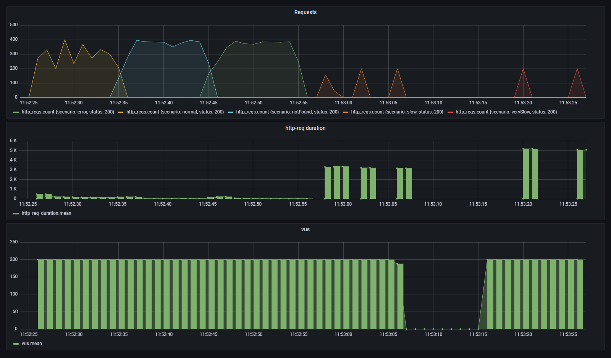
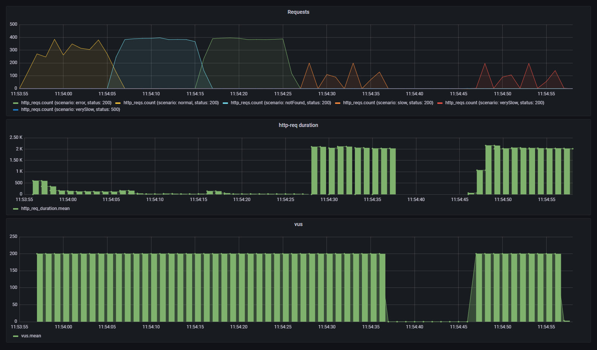
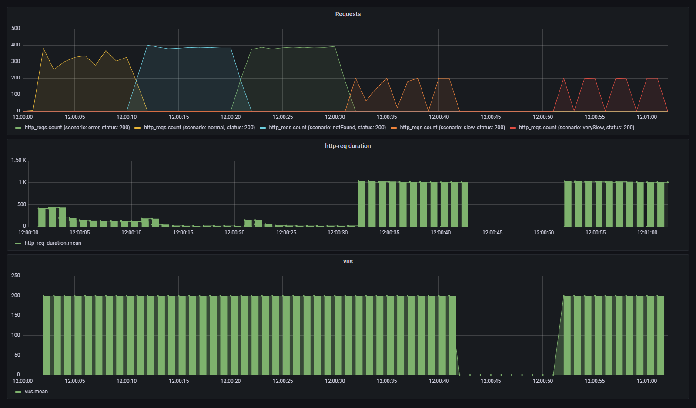
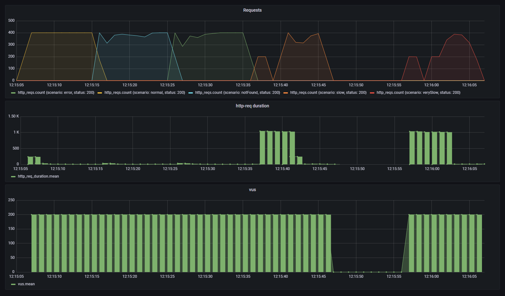
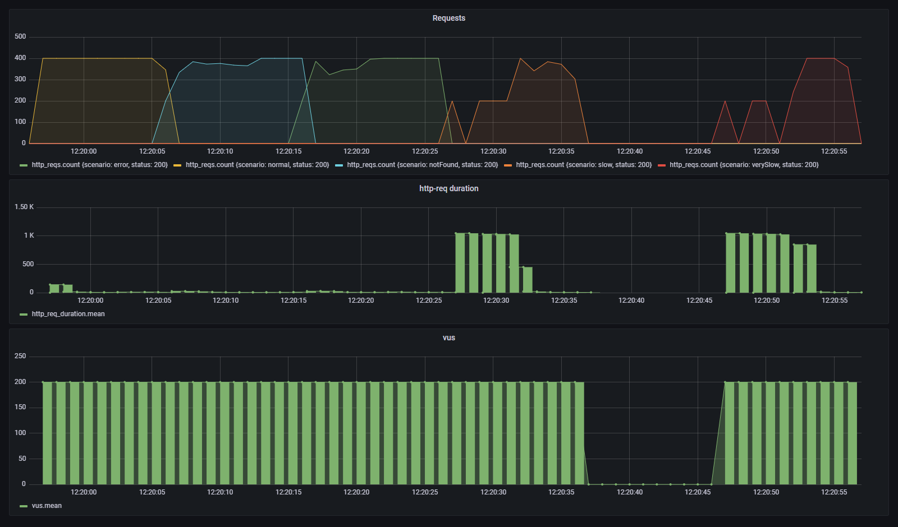

# Performance

How the service behaves under the load test of the statement ([`shared/k6/test.js`](../shared/k6/test.js)), measured at each stage of its evolution.

## How it is measured

- **Load.** The k6 test of the statement, unchanged. Five scenarios run one after another, each with 200 virtual users for 10 seconds. Every user requests the same product over and over, sleeping 0.5 s between requests.
- **Metrics.** [`scripts/perf-report.sh`](../scripts/perf-report.sh) runs the test and queries InfluxDB, where k6 0.28 writes every request with a `scenario` tag. Per scenario it reports requests, throughput over the 10 s of the scenario, latency percentiles and the share of responses other than 200.
- **Products returned.** What the endpoint answers for each scenario right after the run.
- **Dashboard.** A screenshot of the Grafana dashboard of each run is kept in [`performance/`](performance/).

### Environment

| | |
|---|---|
| Machine | Intel Core i7-13700KF (16 cores, 24 threads), 32 GB of RAM |
| OS | Windows 11 Pro 10.0.26300, balanced power plan |
| Application | Temurin JDK 25.0.4.1, `java -jar` on the host with default JVM options |
| Mocks, InfluxDB and k6 | Docker Desktop 29.8.2 |

The mock slows down as it serves requests: three runs in a row of the same code against the same mock took the p95 of `notFound` from 611 ms to 1,882 ms, and the last one failed 17 % of the requests in `normal`. The script therefore restarts simulado before every run, and every table below was measured that way. Even so, the application, the mocks and k6 share the machine, so the numbers are meant to be compared between stages, not read as absolute capacity, and differences below about 2x in the fast scenarios are noise.

### Reproducing a run

Start the infrastructure and the application:

```bash
docker compose up -d simulado influxdb grafana
cd app && ./mvnw -q package -DskipTests && java -jar target/similar-products-api.jar
```

From another terminal at the repository root, run the test and print the table. With a file name, the script also saves the Grafana screenshot, using the browser in `CHROME`:

```bash
scripts/perf-report.sh docs/performance/run.png
```

To see how the service behaves when the existing APIs go down, with the infrastructure and the application running:

```bash
scripts/outage-test.sh
```

## Baseline (v0.1.0)

Sequential implementation: the details of the similar products are requested one after another, with a 1 s connection timeout, a 2 s read timeout and no cache.

| Scenario | Requests | Throughput | p50 | p95 | p99 | Max | Errors | Products returned |
|---|---:|---:|---:|---:|---:|---:|---:|---|
| normal | 2907 | 291 req/s | 154 ms | 539 ms | 630 ms | 679 ms | 0.0 % | 2, 3, 4 |
| notFound | 3704 | 370 req/s | 27 ms | 260 ms | 371 ms | 393 ms | 0.0 % | 1, 2 |
| error | 3664 | 366 req/s | 24 ms | 267 ms | 359 ms | 387 ms | 0.0 % | 1, 2 |
| slow | 600 | 60 req/s | 3214 ms | 3363 ms | 3369 ms | 3373 ms | 0.0 % | 3, 100 |
| verySlow | 400 | 40 req/s | 5100 ms | 5229 ms | 5251 ms | 5252 ms | 0.0 % | 100 |



What the numbers show:

- **Correct, but slow when one product is slow.** Every answer is a 200 with the products the business rules expect, but latencies add up. In `slow`, product 100 costs 1 s and product 1000 the full 2 s read timeout. In `verySlow`, products 1000 and 10000 hit the timeout one after the other. Products 1000 and 10000 are never returned.
- **Slow answers mean fewer requests.** Each virtual user waits for its response before sleeping, so throughput falls from about 300 req/s to 40-60 req/s in the slow scenarios. The load generator measures the latency of the service, not its capacity, once responses take seconds.
- **`normal` is the slowest of the fast scenarios** although it does similar work: it runs first, while the JVM is still warming up, and product 3 takes 100 ms upstream.
- **One thread per request for its whole duration.** Tomcat's default pool of 200 threads matches the 200 users of the test, so nothing queues here. A slower upstream or more concurrent users would exhaust it.

## 1. Parallel lookups on virtual threads

The details of the similar products are requested at once, each blocking a virtual thread, and the request waits for all of them. Timeouts as in the baseline. See [ADR 0005](adr/0005-virtual-threads-over-webflux.md).

| Scenario | Requests | Throughput | p50 | p95 | p99 | Max | Errors | Products returned |
|---|---:|---:|---:|---:|---:|---:|---:|---|
| normal | 3048 | 305 req/s | 118 ms | 608 ms | 675 ms | 732 ms | 0.0 % | 2, 3, 4 |
| notFound | 3858 | 386 req/s | 16 ms | 113 ms | 304 ms | 344 ms | 0.0 % | 1, 2 |
| error | 3849 | 385 req/s | 15 ms | 149 ms | 324 ms | 370 ms | 0.0 % | 1, 2 |
| slow | 800 | 80 req/s | 2053 ms | 2142 ms | 2159 ms | 2161 ms | 0.0 % | 3, 100 |
| verySlow | 806 | 81 req/s | 2037 ms | 2225 ms | 2244 ms | 2255 ms | 0.2 % | 100 |



- **A request now costs its slowest product, not the sum.** The p50 drops from 3.2 s to 2.1 s in `slow` and from 5.1 s to 2.0 s in `verySlow`, both bounded by the 2 s read timeout that products 1000 and 10000 hit. Throughput grows from 60 and 40 req/s to 80 req/s.
- **The fast scenarios stay within the noise or improve** (`notFound` p95 from 260 ms to 113 ms). In `normal`, product 3 takes 100 ms upstream, so that is the floor.
- **First errors.** Two requests of `verySlow` (0.2 %) answered 500 because the call for the similar ids failed with a connection error, not a timeout. Many more calls are now waiting on the mock at the same time.
- **Still far from the goal.** Requests still wait up to the full read timeout, and products 1000 and 10000 never make it into an answer.

## 2. Time budget per request

Requests answer within a budget of 1 s with the products that have arrived. Lookups that miss it keep running but their result is not used yet. See [ADR 0006](adr/0006-time-budget-and-partial-results.md).

| Scenario | Requests | Throughput | p50 | p95 | p99 | Max | Errors | Products returned |
|---|---:|---:|---:|---:|---:|---:|---:|---|
| normal | 3041 | 304 req/s | 121 ms | 549 ms | 637 ms | 661 ms | 0.0 % | 2, 3, 4 |
| notFound | 3848 | 385 req/s | 15 ms | 130 ms | 306 ms | 338 ms | 0.0 % | 1, 2 |
| error | 3839 | 384 req/s | 16 ms | 167 ms | 342 ms | 389 ms | 0.0 % | 1, 2 |
| slow | 1400 | 140 req/s | 1008 ms | 1045 ms | 1046 ms | 1046 ms | 0.0 % | 3 |
| verySlow | 1400 | 140 req/s | 1017 ms | 1039 ms | 1051 ms | 1051 ms | 0.0 % | none |



- **No request waits much longer than the budget.** The p99 of `slow` and `verySlow` drops from about 2.2 s to 1.05 s, and their throughput grows from 80 to 140 req/s.
- **But the slow products are gone.** Product 100 takes about as long as the budget, so it misses it, and `verySlow` now answers an empty list. Every request starts the slow lookups again and nothing keeps their results, so they are never shown. That is what the cache is for.
- The fast scenarios do not change: they never get close to the budget.

## 3. Cache with coalescing and negative caching

Similar ids and product details are cached by outcome, concurrent lookups share one upstream call, and lookups that miss the budget are cached when they arrive. The read timeout grows to 6 s so product 1000 can arrive in the background. See [ADR 0007](adr/0007-cache-strategy.md).

| Scenario | Requests | Throughput | p50 | p95 | p99 | Max | Errors | Products returned |
|---|---:|---:|---:|---:|---:|---:|---:|---|
| normal | 3974 | 397 req/s | 6 ms | 201 ms | 280 ms | 283 ms | 0.0 % | 2, 3, 4 |
| notFound | 4000 | 400 req/s | 5 ms | 50 ms | 65 ms | 66 ms | 0.0 % | 1, 2 |
| error | 4000 | 400 req/s | 8 ms | 40 ms | 62 ms | 64 ms | 0.0 % | 1, 2 |
| slow | 2600 | 260 req/s | 15 ms | 1046 ms | 1048 ms | 1049 ms | 0.0 % | 3, 100, 1000 |
| verySlow | 2400 | 240 req/s | 6 ms | 1044 ms | 1046 ms | 1046 ms | 0.0 % | 100, 1000 |


- **The fast scenarios reach the ceiling of the load test.** 200 users sleeping 0.5 s between requests cannot send more than 400 req/s, and the median answer takes 5 to 8 ms. Only the first requests of `normal`, before the cache is warm, take longer.
- **The slow products are back.** `slow` returns 3, 100 and 1000, and `verySlow` returns 100 and 1000: product 1000 arrives in the background about 5 s after it is first requested and stays cached from then on.
- **The first attempt at a slow product still costs the budget.** Nothing is known about a product until its first lookup ends, so every request in the meantime waits for it until the deadline. In `slow` that lasts until product 1000 arrives, about 5 s. In `verySlow`, until the first attempt at product 10000 gives up after the 6 s read timeout; from then on it is remembered as unavailable and requests answer in milliseconds. InfluxDB shows all `verySlow` requests waiting about 1 s in the first seconds and none afterwards. With 200 users arriving at once, those first seconds are well over 5 % of the requests, so the p95 of both scenarios stays at the budget by construction.

## 4. Circuit breaker and concurrency limit

Calls to the existing APIs go through a circuit breaker and a limit of 100 concurrent calls. See [ADR 0008](adr/0008-upstream-resilience.md).

| Scenario | Requests | Throughput | p50 | p95 | p99 | Max | Errors | Products returned |
|---|---:|---:|---:|---:|---:|---:|---:|---|
| normal | 3973 | 397 req/s | 6 ms | 189 ms | 269 ms | 271 ms | 0.0 % | 2, 3, 4 |
| notFound | 4000 | 400 req/s | 5 ms | 46 ms | 62 ms | 64 ms | 0.0 % | 1, 2 |
| error | 3999 | 400 req/s | 5 ms | 54 ms | 56 ms | 57 ms | 0.0 % | 1, 2 |
| slow | 2600 | 260 req/s | 14 ms | 1041 ms | 1043 ms | 1044 ms | 0.0 % | 3, 100, 1000 |
| verySlow | 2399 | 240 req/s | 13 ms | 1032 ms | 1042 ms | 1043 ms | 0.0 % | 100, 1000 |



- **No change under the load test, as intended.** The broken products (5, 6 and 10000) reach the upstream only once every few seconds thanks to the negative cache, far from the 20 calls in 10 s the circuit needs to open, and the cache keeps concurrent calls well below the limit. The circuit breaker must not trip because of one bad product, and it does not.
- What these guards are for, an upstream that is down as a whole, does not happen in the load test. Their behaviour is covered by tests and by an outage experiment after the error mapping below.

## 5. Retry on connection errors

Calls that fail to connect are retried once, after a short random wait. Timeouts are never retried. See [ADR 0009](adr/0009-retry-on-connection-errors.md).

| Scenario | Requests | Throughput | p50 | p95 | p99 | Max | Errors | Products returned |
|---|---:|---:|---:|---:|---:|---:|---:|---|
| normal | 3946 | 395 req/s | 7 ms | 209 ms | 263 ms | 277 ms | 0.0 % | 2, 3, 4 |
| notFound | 4000 | 400 req/s | 7 ms | 40 ms | 66 ms | 67 ms | 0.0 % | 1, 2 |
| error | 4000 | 400 req/s | 8 ms | 55 ms | 62 ms | 63 ms | 0.0 % | 1, 2 |
| slow | 2600 | 260 req/s | 10 ms | 1048 ms | 1048 ms | 1049 ms | 0.0 % | 3, 100, 1000 |
| verySlow | 2400 | 240 req/s | 9 ms | 1045 ms | 1047 ms | 1048 ms | 0.0 % | 100, 1000 |



- **No change, as expected.** Connection failures were rare even before the cache (0.2 % of one scenario in the parallel run) and have not shown up since. The retry is a safety net for them, covered by tests that reset the connection, and it never adds waits to slow products.

## 6. Gateway errors for upstream failures

Failures to get the similar ids answer 502, 503 (with `Retry-After`) or 504 instead of 500. See [ADR 0010](adr/0010-map-upstream-failures-to-gateway-errors.md).

| Scenario | Requests | Throughput | p50 | p95 | p99 | Max | Errors | Products returned |
|---|---:|---:|---:|---:|---:|---:|---:|---|
| normal | 3802 | 380 req/s | 10 ms | 194 ms | 264 ms | 267 ms | 0.0 % | 2, 3, 4 |
| notFound | 4000 | 400 req/s | 6 ms | 43 ms | 63 ms | 64 ms | 0.0 % | 1, 2 |
| error | 4000 | 400 req/s | 7 ms | 42 ms | 72 ms | 79 ms | 0.0 % | 1, 2 |
| slow | 2600 | 260 req/s | 14 ms | 1042 ms | 1043 ms | 1044 ms | 0.0 % | 3, 100, 1000 |
| verySlow | 2400 | 240 req/s | 7 ms | 1043 ms | 1045 ms | 1046 ms | 0.0 % | 100, 1000 |


No change under the load test, where the similar ids never fail. The difference shows in an outage.

### Outage of the existing APIs

[`scripts/outage-test.sh`](../scripts/outage-test.sh) pauses simulado for 20 seconds. Every second it asks for 10 products never requested before, so they miss the cache, and for product 1, which is cached. Grouped by phase:

| Seconds | simulado | 10 new products per second | Cached product |
|---|---|---|---|
| 0 to 4 | up | 404 in 10 ms (they do not exist) | 200 in under 10 ms |
| 5 to 11 | paused | 504 after 1.01 s, the time budget | 200 in under 10 ms |
| 12 to 19 | paused | 503 in 10 ms: the circuit is open | 200 in under 10 ms |
| 20 | paused | 504 after 1.01 s: the circuit lets trial calls through | 200 in under 10 ms |
| 21 to 33 | paused, then up from 25 | 503 in 10 ms: the trial calls failed and the circuit opened again | 200 in under 10 ms |
| 34 to 39 | up | 404 in 10 ms: the circuit closed | 200 in under 10 ms |

- **No request waits longer than the budget**, although the upstream hangs and each call keeps running until its 6 s read timeout.
- **The circuit opens about 7 s into the outage.** Failures count when calls end, after the read timeout. From then on, requests fail in 10 ms with `Retry-After: 10` instead of waiting a second each, and the upstream receives no traffic.
- **Cached products are served throughout.** Product 1 answers 200 for the whole outage, from the cache.
- **Recovery takes up to the open wait.** The trial calls at second 20 failed because simulado was still paused, so the circuit opened again and only closed at second 34, 9 s after simulado came back. A shorter wait recovers sooner, at the cost of more trial calls against a sick upstream.

## Evolution

p95 per scenario at each stage, and what `slow` and `verySlow` return:

| Stage | normal | notFound | error | slow | verySlow | slow returns | verySlow returns |
|---|---:|---:|---:|---:|---:|---|---|
| Baseline | 539 ms | 260 ms | 267 ms | 3363 ms | 5229 ms | 3, 100 | 100 |
| 1. Parallel lookups | 608 ms | 113 ms | 149 ms | 2142 ms | 2225 ms | 3, 100 | 100 |
| 2. Time budget | 549 ms | 130 ms | 167 ms | 1045 ms | 1039 ms | 3 | none |
| 3. Cache | 201 ms | 50 ms | 40 ms | 1046 ms | 1044 ms | 3, 100, 1000 | 100, 1000 |
| 4. Circuit breaker and limit | 189 ms | 46 ms | 54 ms | 1041 ms | 1032 ms | 3, 100, 1000 | 100, 1000 |
| 5. Retry | 209 ms | 40 ms | 55 ms | 1048 ms | 1045 ms | 3, 100, 1000 | 100, 1000 |
| 6. Gateway errors | 194 ms | 43 ms | 42 ms | 1042 ms | 1043 ms | 3, 100, 1000 | 100, 1000 |

From the baseline to the final stage, the p50 of every scenario is under 15 ms, throughput reaches the ceiling of the load test in the fast scenarios, no request waits more than about a second, and the slow products 100 and 1000 are returned once they have arrived. Product 10000, which takes 50 s, is never returned.
